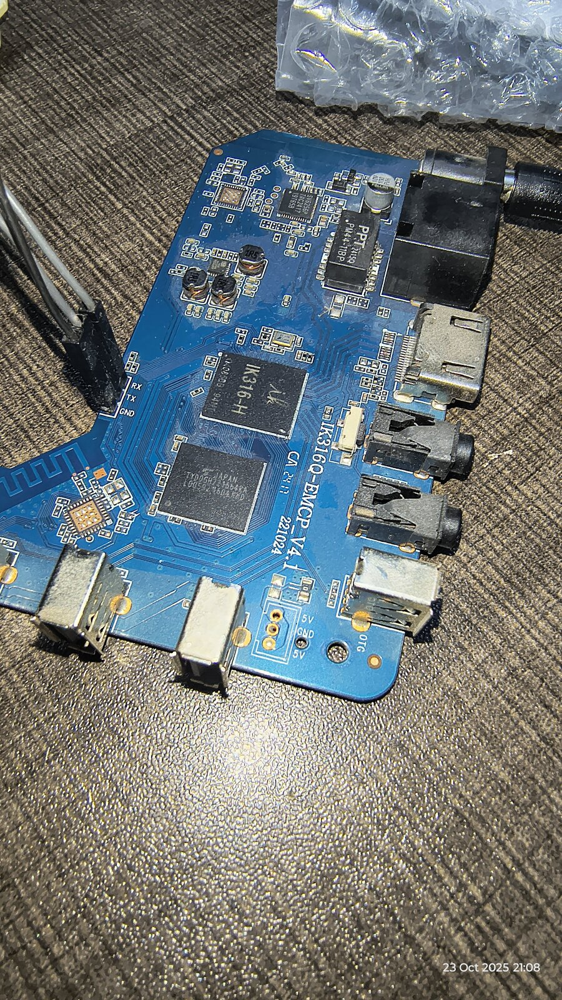

# IK316 eMCP

This directory records the H616 board facts and the Armbian changes.

Read [soc.md](soc.md) for the hardware.
Read [changes.md](changes.md) for the source changes.
Read [install.md](install.md) for install and update steps.

The stock Android device tree and boot0 supply the pin and DRAM facts.
The running board confirms the SoC, the memory size, Ethernet, Wi-Fi, and the eMMC boot.
The board packages use the official Armbian package names.
The image freezes them with `apt-mark hold`, see [install.md](install.md).

## Photos

The PCB silkscreen is `IK316Q-EMCP_V4.1 221024`.
The debug header is `RX TX GND`, next to the SoC.

| Photo                                                  | Content                                           |
| ------------------------------------------------------ | ------------------------------------------------- |
| [board-top.jpg](photos/board-top.jpg)                  | Top side                                          |
| [soc-serial-header.jpg](photos/soc-serial-header.jpg)  | SoC, eMCP, 24 MHz crystal, and the debug header   |
| [soc-ik316h-emcp.jpg](photos/soc-ik316h-emcp.jpg)      | `IK316-H` SoC marking and the eMCP                |
| [wifi-sv6256p.jpg](photos/wifi-sv6256p.jpg)            | iComm SV6256P Wi-Fi chip and the Ethernet magnetics |
| [pmic-wifi-ethernet.jpg](photos/pmic-wifi-ethernet.jpg) | PMIC area, SoC heat sink, Wi-Fi, and Ethernet     |

