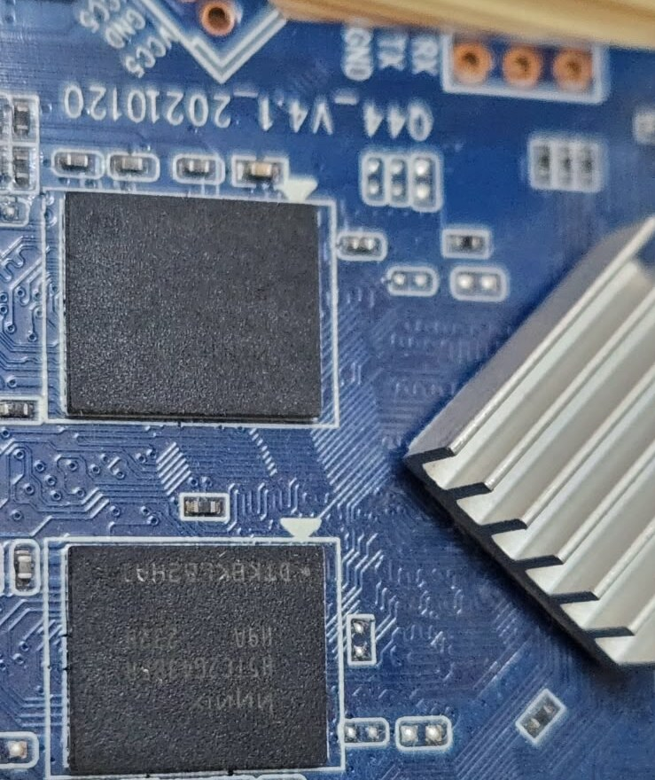

# MXQ H3 Q44

This directory records the H3 TV box facts and the Armbian changes.

Read [soc.md](soc.md) for the hardware.
Read [changes.md](changes.md) for the source changes.
Read [install.md](install.md) for install and update steps.

The stock Android image and the PCB photos supply the hardware facts.
The pin layout is the same as the Sunvell R69 in upstream Armbian.
The board packages use the official Armbian package names.
The image freezes them with `apt-mark hold`, see [install.md](install.md).

## Names

| Source                          | Name                  |
| ------------------------------- | --------------------- |
| Stock Android `ro.product.model` | `Ausha MXQ`          |
| PCB silkscreen                  | `Q44_V4.1_20210120`   |
| Allwinner reference design      | `dolphin-fvd-p1`      |
| Armbian board id                | `mxq-h3`              |
| Armbian board name              | `MXQ H3 Q44`          |
| Kernel device tree              | `sun8i-h3-mxq.dtb`    |

Many boxes use the name MXQ.
These boxes use different SoCs.
Use the PCB name `Q44` to identify this board.

## Status

The board test used kernel 7.3.1 and U-Boot v2024.01 with `orangepi_pc_plus_defconfig`.
The test device tree has the final CPU settings.
The final tree also fixes the thermal cooling maps.
The final image is not tested on the board yet.

| Function                 | Status                                          |
| ------------------------ | ----------------------------------------------- |
| Image build, current     | Builds, kernel 6.18.60                          |
| Image build, edge        | Builds, kernel 7.3.1                            |
| Cold boot, SD and eMMC   | Works                                           |
| Warm reboot, eMMC        | Works                                           |
| CPU and RAM stress       | 10 min at 1008 MHz, 0 errors, 74 °C peak        |
| Ethernet                 | Works, 100 Mbit/s full duplex                   |
| HDMI video               | Works                                           |
| Audio                    | Codec and HDMI devices register. Playback not tested. |
| Wi-Fi                    | Scan, WPA connect, and DHCP work                |
| IR receiver              | Registers as `rc0`. Remote not tested.          |
| LEDs, USB, SD, eMMC      | Work. eMMC runs DDR52, 8 bits.                  |
| Kernel 6.18 on the board | Not tested                                      |

The CPU runs at 1008 MHz at most.
The stock firmware uses the same limit at a fixed 1.30 V.
U-Boot v2026.07 does not boot this board, see [changes.md](changes.md).

## Photos

The debug header is `RX TX GND`, next to the RAM.
The SoC is under the heat sink.

| Photo                                                    | Content                                          |
| -------------------------------------------------------- | ------------------------------------------------ |
| [pcb-label-ram.jpg](photos/pcb-label-ram.jpg)            | PCB name, debug header, RAM, and heat sink       |
| [ram-serial-pads.jpg](photos/ram-serial-pads.jpg)        | Both RAM chips and the debug header              |
| [emmc-wifi-ethernet.jpg](photos/emmc-wifi-ethernet.jpg)  | eMMC, Wi-Fi chip, and Ethernet magnetics         |
| [emmc-kioxia.jpg](photos/emmc-kioxia.jpg)                | Kioxia `THGBMHG6C1LBAIL` eMMC marking            |
| [wifi-sv6256p.jpg](photos/wifi-sv6256p.jpg)              | iComm `SV6256P` Wi-Fi chip marking               |

