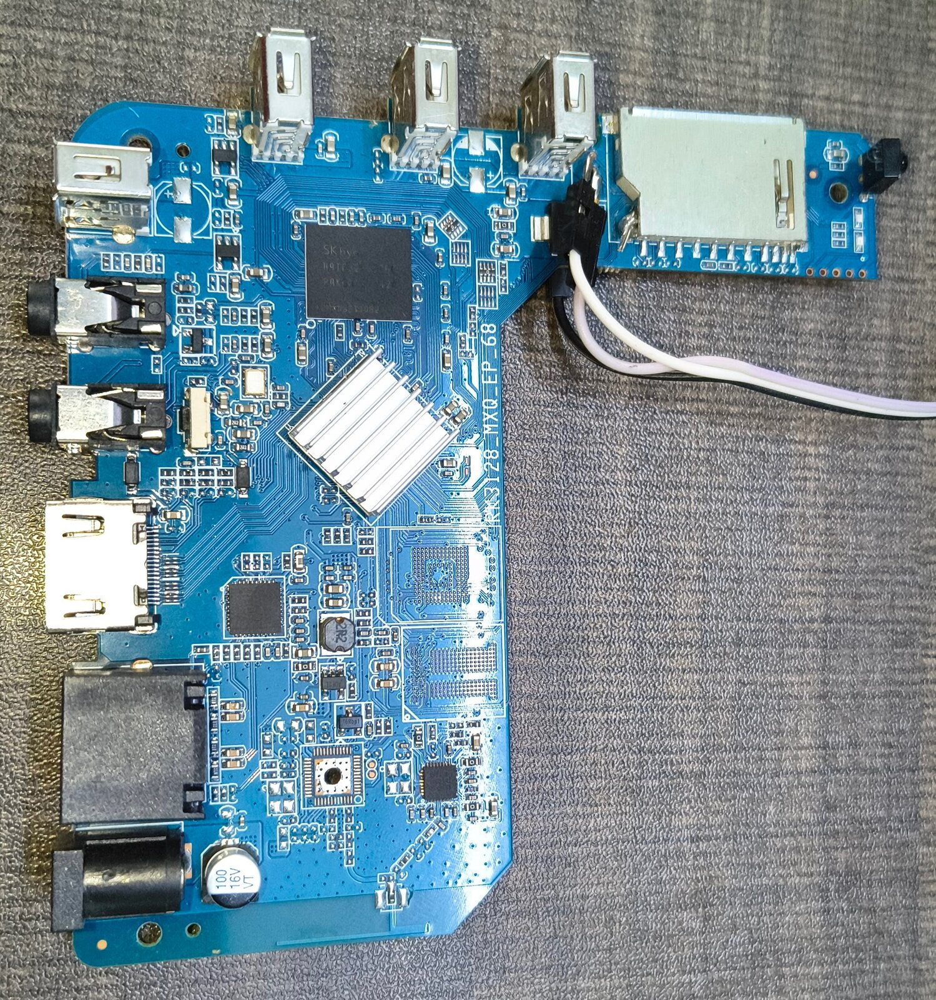

# RK3128 TV box

This directory records the RK3128 board facts and the Armbian changes.

Read [soc.md](soc.md) for the hardware.
Read [changes.md](changes.md) for the source changes.
Read [install.md](install.md) for install and update steps.
Read [analog-audio.md](analog-audio.md) for the open analog audio work.

The factory eMMC dump supplies the pin, clock, and partition facts.
The running board confirms the SoC, the memory size, Ethernet, Wi-Fi, HDMI, and the eMMC boot.

## Status

| Function              | Status                                              |
| --------------------- | --------------------------------------------------- |
| SD boot               | Works                                               |
| eMMC boot             | Works, without an SD card                           |
| Ethernet              | Works, 100 Mb/s full duplex, DHCP, cold boot        |
| Wi-Fi                 | Works, `ssv6158`, 2.4 GHz                           |
| HDMI video            | Works, 1920x1080                                    |
| HDMI audio            | Works, I2S, left and right channels checked         |
| S/PDIF                | The sound card registers. Output is not tested.     |
| Analog audio          | Not supported. See [analog-audio.md](analog-audio.md). |
| CVBS video            | Not supported. Mainline has no RK3128 TV encoder.   |
| CPU frequency scaling | Works, 216 MHz to 1.2 GHz                           |
| GPU frequency scaling | Works, 200 MHz to 480 MHz                           |
| Watchdog              | Works                                               |
| Power key             | Works                                               |
| IR receiver           | `rc0` gets scancodes. No keymap is set.             |
| USB                   | The host and OTG controllers register.              |
| Thermal               | Not available. RK3128 has no TSADC.                 |
| Serial console        | U-Boot only. Linux gives the pins to the SD card.   |

The table applies to kernel 6.18.58.
Edge uses only kernel.org stable releases.
The edge image uses kernel 7.3.1.
Early edge images froze when `ssv6158` loaded at boot.
The 7.2.12 edge image boots, scans Wi-Fi, and passes 6 reboots.
The 7.3.1 edge image is not tested on the board.

## Known limitations

The board has no analog audio and no CVBS video.
The board has no thermal sensor.
Use a heat sink for long loads at 1.2 GHz.
Linux has no serial console.
The infrared receiver has no keymap.
Load a keymap with `ir-keytable`.
The factory remotes use NEC user codes 0xfe01, 0xff00, 0x1dcc, and 0x4040.
The board packages use the official Armbian package names.
The image freezes them with `apt-mark hold`.
Update them only with debs from this build tree, see [install.md](install.md).

## Photos

The PCB top silkscreen is `RK3128_MXQ_EP_68`.
The PCB bottom silkscreen is `FDX-M 2203`.

| Photo                                                                  | Content                                         |
| ---------------------------------------------------------------------- | ----------------------------------------------- |
| [board-top.jpg](photos/board-top.jpg)                                  | Top side                                        |
| [board-bottom.jpg](photos/board-bottom.jpg)                            | Bottom side                                     |
| [soc-rk3128.jpg](photos/soc-rk3128.jpg)                                | Rockchip RK3128 SoC                             |
| [emcp-skhynix-h9tp32a8jdbc.jpg](photos/emcp-skhynix-h9tp32a8jdbc.jpg) | SK hynix H9TP32A8JDBC, eMMC and LPDDR2 in one package |
| [wifi-ssv6158.jpg](photos/wifi-ssv6158.jpg)                            | iComm SSV6158 Wi-Fi chip                        |
| [ethernet-phy-dp83848.jpg](photos/ethernet-phy-dp83848.jpg)            | TI DP83848 Ethernet PHY                         |

